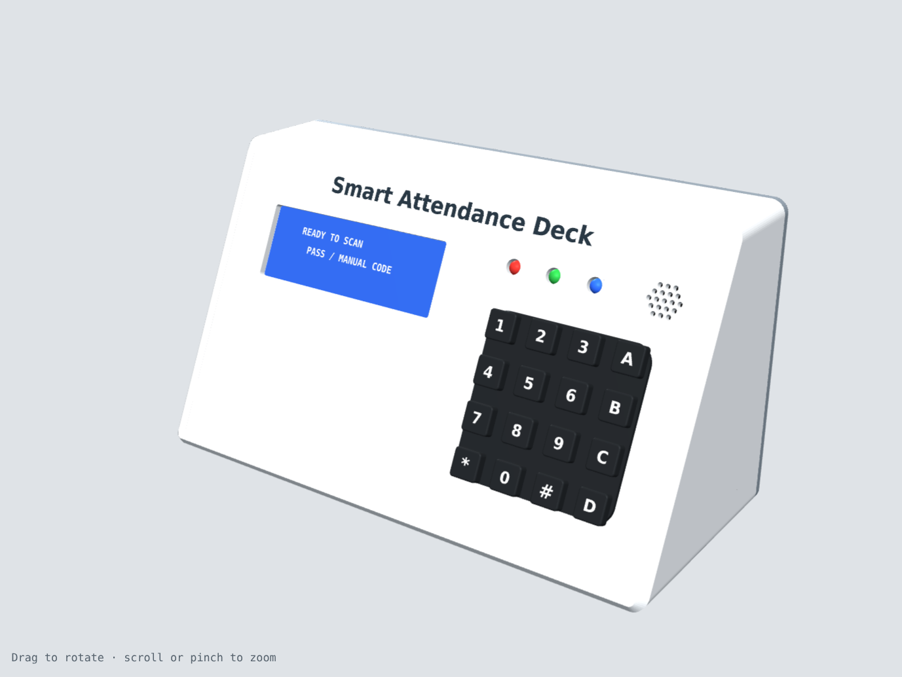
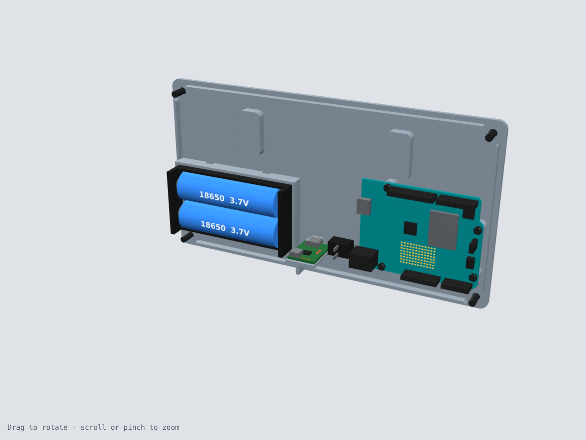
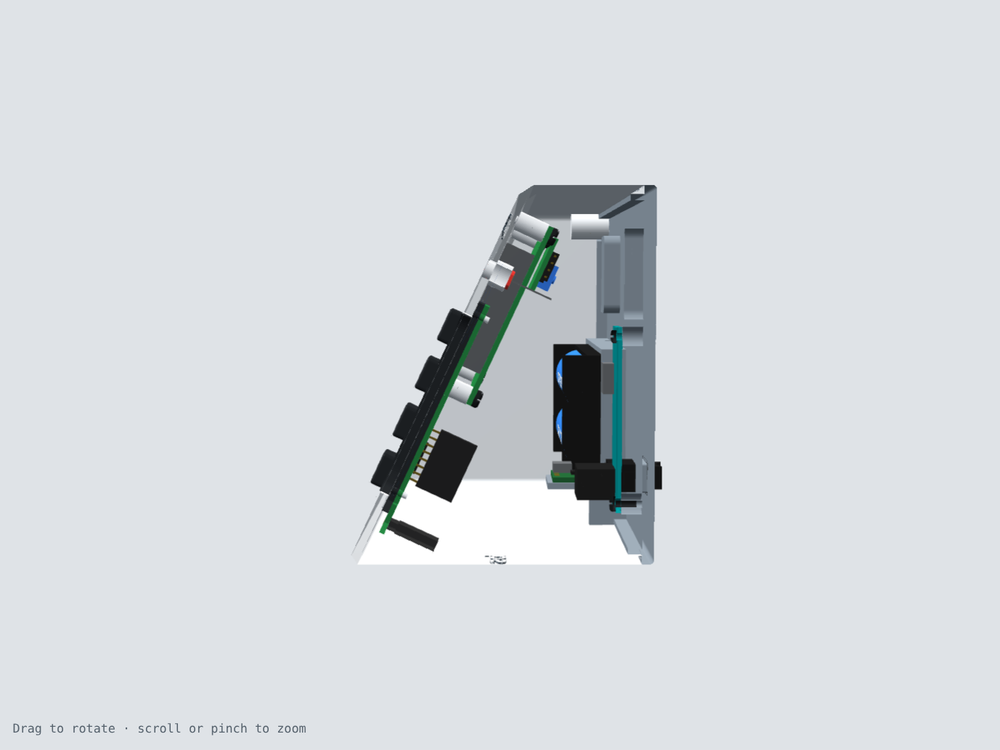
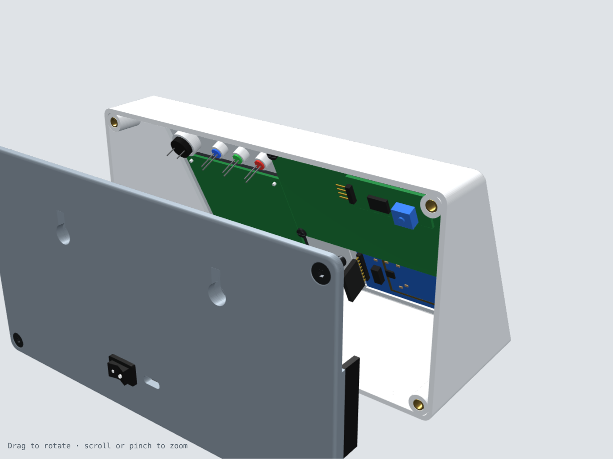
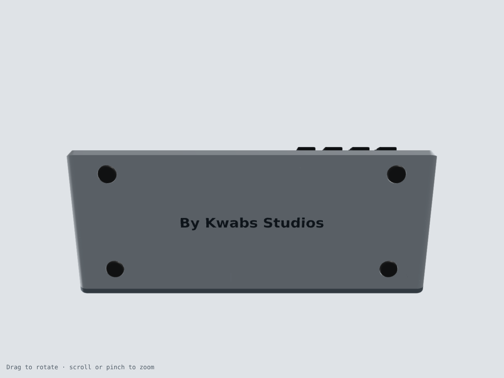

# Smart Attendance Deck

A desk or wall-mounted attendance terminal. People tap an RFID card or enter a code on the keypad, and the 20×4 LCD, three status LEDs and a buzzer confirm it. It runs on an Arduino UNO R4 WiFi and a rechargeable 2S 18650 pack that charges over USB-C.

This repository holds the full 3D design: a printable two-part enclosure, models of every electronic part, and a coloured STEP assembly that opens in Autodesk Inventor, Fusion, SolidWorks, FreeCAD and similar CAD programs.

*By Kwabs Studios*



| Inside the back cover | Cut-through side view |
|---|---|
|  |  |

| Back, exploded | Underside |
|---|---|
|  |  |

**Interactive 3D viewer:** open [`docs/index.html`](docs/index.html) in a browser, or turn on GitHub Pages (see below). You can rotate the model, pull the back off, and cut a section through it.

---

## What's in the repo

```
cad/
  smart_attendance_deck_assembly.step           full assembly, everything in place
  smart_attendance_deck_assembly_exploded.step  same, back cover pulled 70 mm back
  parts/front_shell.step, back_cover.step       the two printed parts
  components/*.step                             each electronic part / fastener on its own
print/
  front_shell.stl, back_cover.stl               already oriented for printing
renders/                                        images used in this README
docs/index.html                                 interactive 3D viewer (GitHub Pages ready)
src/
  enclosure.py      parametric enclosure (all dimensions at the top of the file)
  components.py     component models
  assembly.py       places everything, checks for overlaps, exports STEP / STL
  make_viewer.py    builds docs/index.html
  fonts/            DejaVu fonts used for the engraved text
```

## Specifications

| | |
|---|---|
| Overall size | 200 × 108.8 × 88.5 mm (W × H × D) |
| Front face | 120 mm along the slope, tilted 65° |
| Walls | 2.5 mm shell, 3.5 mm back plate, 1.8 mm over the RFID antenna |
| Edges | 3 mm chamfer around the front face, R5 body edges |
| Engraving | "Smart Attendance Deck" on the front, "By Kwabs Studios" on the base, both 0.6 mm deep |
| Mounting | Stands on four rubber feet, or hangs on two keyhole slots |

## Bill of materials

### Electronics

| Qty | Part | Notes |
|---|---|---|
| 1 | Arduino UNO R4 WiFi | On 6 mm standoffs on the back cover |
| 1 | 20×4 character LCD (2004A) with I2C backpack (PCF8574) | Screwed to 4 standoffs behind the window |
| 1 | RC522 RFID reader, 13.56 MHz | Slides into a holder behind the 1.8 mm tap window |
| 1 | 4×4 hard plastic matrix keypad, 8-pin | Key area pokes through the panel |
| 3 | 5 mm LED: red, green, blue | Push in from inside |
| 1 | 12 mm piezo buzzer | Held in a ring behind the grille |
| 1 | 2 × 18650 battery holder (77 × 41 mm) + 2 cells | Sits in a tray on the back cover |
| 1 | 2S (8.4 V) USB-C charge board, about 17 × 24 mm | Sits on a shelf; USB-C lines up with the back opening |
| 1 | KCD11 mini rocker switch (13 × 8.5 mm cut-out) | Snaps into the back cover |

### Hardware

| Qty | Part |
|---|---|
| 4 | M4 heat-set insert, Ø5.6 × 8.1 mm |
| 4 | M4 × 12 countersunk screw (ISO 10642) |
| 4 | M3 × 6 pan-head self-tapping screw (LCD) |
| 4 | M2.5 × 6 pan-head self-tapping screw (Arduino) |
| 4 | Ø10 × 2.5 mm rubber bumper |
| 2 | Wall screws, head no bigger than Ø8.5 mm (optional) |

## Printing

| Part | Orientation | Supports |
|---|---|---|
| `front_shell.stl` | Front face down on the bed | None |
| `back_cover.stl` | Outside face down | None |

- Material: PLA or PETG. PETG copes better with a warm room or sunlight.
- Settings: 0.2 mm layers, 4 perimeters, 20% infill.
- Bed size: needs at least 220 × 220 mm. The front shell is 200 mm wide.
- To make the engraved text stand out, rub acrylic paint or a paint marker into it and wipe the surface clean.

## Assembly

1. Press the four M4 heat-set inserts into the corner bosses of the front shell with a soldering iron.
2. Stick the rubber feet into the four round recesses under the base.
3. Push the three LEDs into their sleeves from inside: red, green, blue, left to right. Press the buzzer into its ring.
4. Slide the RC522 into its holder behind the RFID window, chip side facing in, so the header ends up at the open right-hand end.
5. Fit the keypad from inside so the key area comes through the cut-out. Melt the tips of the four printed pins with a soldering iron, or glue them, to hold it.
6. Screw the LCD to its four standoffs with M3 × 6 screws.
7. On the back cover, screw the Arduino to its standoffs with M2.5 × 6 screws, put the battery holder in its tray (cable ties go through the slots), set the charge board on its shelf, and snap the rocker switch in from outside.
8. Wire everything up, close the case, and fit the four M4 × 12 countersunk screws.

## Opening it in Autodesk Inventor

1. **File → Open**, set the file type to **STEP Files**, and pick `cad/smart_attendance_deck_assembly.step`.
2. In the import dialog choose **Convert Model**. Inventor builds an assembly (.iam) with a separate part for each component, in its STEP colours.
3. The printed parts are under `cad/parts/` if you want to edit them on their own. They arrive as solid bodies without feature history. Use **Direct Edit**, or add new features on top.

## Changing the design

All main dimensions are at the top of `src/enclosure.py`: width, slope angle, wall thickness, component positions, the engraved text, and so on.

```bash
pip install -r requirements.txt
python src/assembly.py --out build        # rebuilds parts, checks for overlaps, exports STEP/STL
python src/make_viewer.py --build build   # rebuilds docs/index.html
```

`assembly.py` prints `interference check: PASS` when no two parts overlap.

## Measure before you print

Different sellers' parts vary in size. Check these against your own and change `src/enclosure.py` if they're off by more than about 0.5 mm:

- **Keypad:** back plate 68 × 66 mm, corner holes 60 × 58 mm apart, raised key area 58 × 56 mm, 3.5 mm from the back of the board to the front of the plate.
- **LCD:** 9.5 mm from the front of the metal frame to the circuit board.
- **Rocker switch:** 13.2 × 8.8 mm cut-out.
- **Charge board:** its USB-C port must sit on top of the board, so it lines up with the back opening.

## Viewing on GitHub Pages

In this repository go to **Settings → Pages**. Set **Source** to *Deploy from a branch*, choose **main** and **/docs**, then click Save. The viewer appears at `https://<your-username>.github.io/<repo-name>/`.
